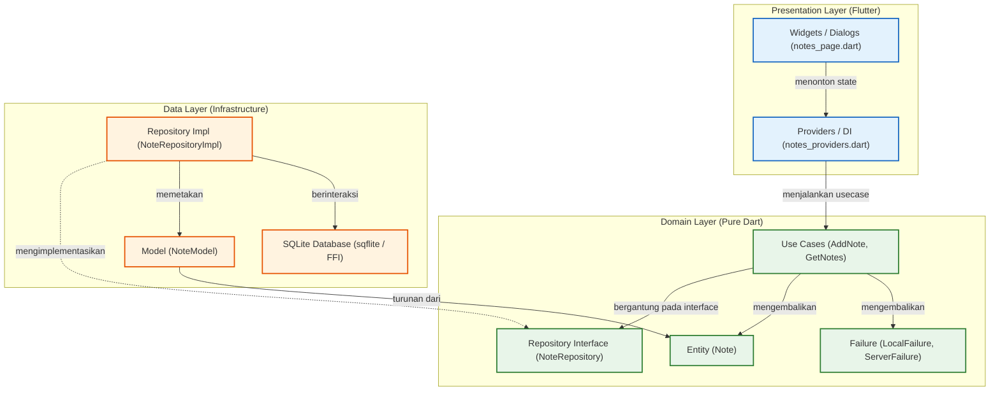
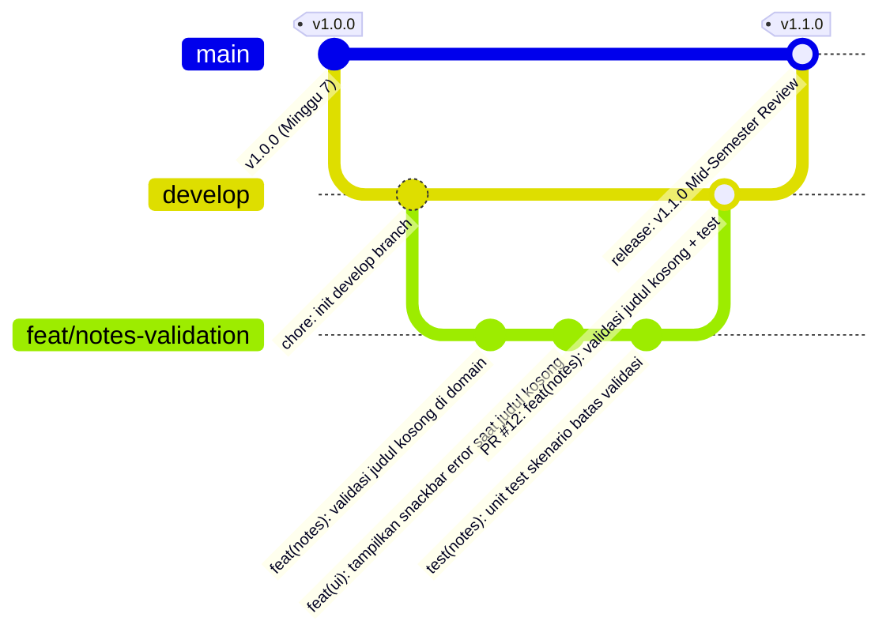

# Laporan Praktikum Minggu 8: Mid Project Review & Code Review

|  | Pemrograman Mobile |
|--|--|
| NIM |  244107020212|
| Nama |  Naufal Abid Aurizky |
| Kelas | TI - 3G |

---

## 1. Pendahuluan & Tujuan Pembelajaran

Praktikum Minggu 8 berfokus pada **kolaborasi tim profesional**, **tinjauan kode (*peer code review*)**, **kebersihan alur kerja Git (*Git flow & commit hygiene*)**, **verifikasi otomatis dengan mesin (*static analysis & CI*)**, serta **evaluasi kritis terhadap saran kecerdasan buatan (*AI review verification*)**.

Setelah menyelesaikan praktikum ini, mahasiswa mampu:
1. Menjelaskan dan mempraktikkan **Git Flow** serta strategi branching terstruktur (`main`, `develop`, `feature/*`, `fix/*`).
2. Menulis pesan commit berbasis standar **Conventional Commits** dan membuka **Pull Request (PR)** berkualitas tinggi yang mudah direview.
3. Melakukan **Peer Code Review** konstruktif menggunakan pola standar: *Observasi $\rightarrow$ Dampak $\rightarrow$ Usulan Konkret*.
4. Menjalankan pemeriksaan mesin otomatis secara bersih: `flutter analyze`, `dart format`, dan `flutter test`.
5. Mengonfigurasi **Continuous Integration (CI)** dengan GitHub Actions (`.github/workflows/ci.yml`).
6. Menilai kesiapan proyek paruh semester (*Mid-Project Review Readiness*) berbasis arsitektur **Feature-First Clean Architecture**.
7. Menelaah dan memvalidasi saran *AI Reviewer*, menerima temuan yang valid dengan bukti, serta menolak usulan yang melanggar prinsip arsitektur perangkat lunak.

---

## 2. Status Proyek Paruh Semester (Mid-Project Status)

Aplikasi yang dikembangkan dan direview pada Minggu 8 merupakan kelanjutan dari proyek portofolio **Notes App (Clean Architecture)**:

```text
08-Week-8-Mid-Project-Review-and-Code-Review/
├── .github/
│   └── workflows/
│       └── ci.yml               # Workflow Continuous Integration (CI)
├── docs/
│   ├── ai-review-vs-keputusan.md # Analisis 5 temuan AI vs keputusan teknis
│   └── review-checklist.md       # Audit git, konvensi commit, checklist PR & mid-review
├── lib/
│   ├── core/
│   │   ├── failures.dart        # Domain failure murni Dart
│   │   ├── format.dart          # Formatting tanggal & utilitas string
│   │   └── providers.dart       # Core provider
│   ├── features/
│   │   └── notes/
│   │       ├── data/
│   │       │   ├── models/note_model.dart
│   │       │   └── repositories/note_repository_impl.dart
│   │       ├── domain/
│   │       │   ├── entities/note.dart
│   │       │   ├── repositories/note_repository.dart  # Interface domain
│   │       │   └── usecases/
│   │       │       ├── add_note.dart                  # UseCase validasi judul
│   │       │       └── get_notes.dart
│   │       └── presentation/
│   │           ├── pages/notes_page.dart              # UI dialog + error SnackBar
│   │           └── providers/notes_providers.dart     # Riverpod State Provider & DI
│   ├── main.dart
│   └── routes.dart
├── screenshots/                 # Bukti tangkapan layar pengujian & review
│   └── README.md
├── test/
│   ├── add_note_test.dart
│   ├── format_test.dart
│   ├── get_notes_test.dart
│   └── validate_note_test.dart  # Pengujian khusus kasus batas validasi
├── analysis_options.yaml
└── pubspec.yaml
```

### Diagram Arsitektur & Aturan Dependensi (Dependency Rule)
Arsitektur tetap mempertahankan prinsip **Feature-First Clean Architecture** di mana panah dependensi hanya mengarah ke dalam (*inward dependency*):



---

## 3. Peta Issue & Alur Kerja Git Flow

Alur kerja kolaboratif mengadopsi standar **Git Flow** ketat: branch `main` dilindungi untuk rilis stabil, branch `develop` berfungsi sebagai integrasi mingguan, dan seluruh pengembangan fitur dilakukan pada branch pendek `feature/*`:



### Siklus Penanganan Fitur:
1. **Issue Terdaftar**: Issue **#12** dibuat dengan judul *"Validasi judul catatan kosong dan umpan balik kesalahan pada UI"*.
2. **Branch Khusus**: Pengembang membuat branch kerja `feat/notes-validation` dari `develop`.
3. **Commit Atomik**: Setiap commit menyelesaikan satu perubahan logis disertai deskripsi tipe konvensional.
4. **Pull Request**: Diajukan ke `develop` dengan template terstruktur yang otomatis menutup issue (`Closes #12`).
5. **Peer Review & Mesin Hijau**: Diuji otomatis oleh CI (`flutter analyze`, `dart format`, `flutter test`) dan disetujui (*Approve*) oleh rekan sejawat.
6. **Squash & Merge**: Digabungkan ke `develop` secara rapi dan branch fitur dihapus.

---

## 4. Praktikum 1: Hygiene Branch & Commit

### A. Audit Riwayat Repositori
Eksekusi audit riwayat Git pada repositori lokal:
```bash
git log --oneline -15
git branch -a
git status
```

**Temuan Masalah pada Riwayat Sebelumnya**:
- **Commit langsung ke `main`**: Pada pengerjaan awal, pekerjaan langsung dilakukan pada branch `main` tanpa isolasi branch fitur.
- **Pesan commit generik**: Terdapat pesan commit seperti `img`, `feat: new img`, `feat: report revision`, dan `feat: complete the report`.
- **Ketidakjelasan Scope**: Reviewer tidak dapat mengetahui modul apa yang dimodifikasi tanpa melihat seluruh baris perubahan (*diff*).

### B. Branching Model yang Benar
Pekerjaan fitur baru dimulai dengan memastikan sinkronisasi branch `develop` dan membuat branch fitur:
```bash
git checkout develop
git pull origin develop
git checkout -b feat/notes-validation
# kerjakan perubahan fitur secara atomik ...
git add -p
git commit -m "feat(notes): validasi judul kosong + test"
```

### C. Simulasi Standarisasi Pesan Commit Lama
Sesuai instruksi Praktikum 1 Langkah 3, dilakukan penulisan ulang 3 commit lama menjadi format **Conventional Commits** (`docs/review-checklist.md`):

| No | Commit Lama | Format Conventional Commit Baru | Alasan Teknis |
| :---: | :--- | :--- | :--- |
| **1** | `e58bd78 img` | `docs(week3): tambahkan screenshot demo provider & routing` | Pesan lama `img` sangat ambigu; format baru memperjelas tipe `docs`, ruang lingkup `week3`, serta objek tangkapan layar yang ditambahkan. |
| **2** | `fb60083 feat: complete the report` | `docs(week6): lengkapi laporan auth token refresh & fcm listener` | Mengubah tipe keliru `feat` menjadi `docs`, serta menjelaskan spesifik materi otentikasi Minggu 6 dan FCM. |
| **3** | `40f1847 feat: complete the praktikum` | `feat(notes): implementasi usecase validasi judul kosong + unit test` | Memungkinkan penelusuran riwayat secara akurat jika diperlukan `git revert` atau peninjauan *changelog*. |

---

## 5. Praktikum 2: Pull Request & Peer Review

### A. Template Pengajuan Pull Request (PR)
Pull request dari branch `feat/notes-validation` menuju `develop` diajukan dengan template standar:

```markdown
Judul: feat(notes): validasi judul kosong + test

Masalah:
Pengguna dapat menekan tombol Simpan tanpa memasukkan judul catatan. Sebelumnya sistem
tidak memberikan respons apa pun di UI sehingga menimbulkan kebingungan pengguna (silent failure).

Solusi:
1. Validasi di Use Case (AddNote) untuk memeriksa apakah judul kosong atau hanya berisi whitespace.
2. Mengembalikan Failure domain bertipe LocalFailure('Judul catatan tidak boleh kosong.').
3. Menampilkan SnackBar merah di UI jika hasil penambahan mengembalikan failure.

Cara Uji:
1. Tambah catatan dengan judul kosong atau spasi -> SnackBar error merah muncul di layar.
2. Jalankan unit test: flutter test test/validate_note_test.dart -> 4 skenario batas lulus 100%.

Closes #12
```

### B. Hasil Peer Code Review 15 Menit
Tinjauan kode sejawat menghasilkan umpan balik konstruktif dengan format **Observasi $\rightarrow$ Dampak $\rightarrow$ Usulan Konkret**:

```text
[Temuan Kebenaran #1]
- Observasi: Tombol Simpan sebelumnya menggunakan 'if (title.trim().isNotEmpty)'.
- Dampak: Jika judul kosong, tidak ada notifikasi kesalahan sama sekali di antarmuka pengguna.
- Usulan: Panggil usecase dan tangkap 'result.failure', lalu tampilkan SnackBar merah.

[Temuan Kebenaran #2]
- Observasi: Validasi 'isEmpty' tanpa 'trim()' meloloskan string berupa karakter spasi/tab.
- Dampak: Basis data SQLite terisi oleh catatan kosong tanpa teks.
- Usulan: Lakukan pembersihan awal 'final cleanTitle = title.trim(); if (cleanTitle.isEmpty) ...'.

[Temuan Arsitektur]
- Observasi: Terdapat usulan untuk memvalidasi string langsung di database helper.
- Dampak: Memindahkan aturan bisnis ke layer data merusak prinsip Single Source of Truth pada domain.
- Usulan: Pertahankan validasi di dalam Use Case (Domain Layer).

[Temuan Pengujian]
- Observasi: Kasus batas whitespace campuran belum tercakup pada test lama.
- Dampak: Potensi regresi logika trim di masa depan tidak terdeteksi mesin.
- Usulan: Buat pengujian mandiri di 'test/validate_note_test.dart'.

[Saran Keterbacaan]
- Observasi: Terdapat baris kode yang melebihi batas panjang karakter dan inkonsistensi spasi.
- Dampak: Memperumit pembacaan git diff.
- Usulan: Terapkan 'dart format' otomatis pada workflow CI.
```

**Keputusan Reviewer**: **APPROVED** setelah seluruh rekomendasi diimplementasikan.

---

## 6. Praktikum 3: Static Analysis & CI Automation

### A. Eksekusi Tiga Pemeriksaan Mesin
Sebelum Pull Request dinyatakan siap digabungkan, tiga pemeriksaan mesin wajib berstatus hijau:

#### 1. Static Analysis (`flutter analyze`)
```powershell
flutter analyze
```
> **Output**:
> ```text
> Analyzing 08-Week-8-Mid-Project-Review-and-Code-Review...
> No issues found! (ran in 3.7s)
> ```

#### 2. Formatter Kode Dart (`dart format`)
```powershell
dart format --output=none --set-exit-if-changed .
```
> **Output**:
> ```text
> Formatted 17 files (0 changed) in 0.10 seconds.
> ```
*(Exit Code: 0 - Seluruh file Dart bersih dan konsisten sesuai kaidah resmi Dart)*.

#### 3. Pengujian Unit Test (`flutter test`)
```powershell
flutter test
```
> **Output**:
> ```text
> 00:00 +0: loading test/add_note_test.dart
> 00:00 +0: test/add_note_test.dart: AddNote berhasil menambahkan catatan ketika judul valid
> 00:00 +1: test/add_note_test.dart: AddNote mengembalikan ValidationFailure/LocalFailure ketika judul kosong
> 00:00 +2: test/format_test.dart: Core Format & Utilities Unit Tests formatRelativeTime returns "Baru saja" for recent timestamps
> 00:00 +3: test/format_test.dart: Core Format & Utilities Unit Tests formatRelativeTime returns minutes ago correctly
> 00:00 +4: test/format_test.dart: Core Format & Utilities Unit Tests formatRelativeTime returns "Hari ini, HH:mm" on same day
> 00:00 +5: test/format_test.dart: Core Format & Utilities Unit Tests formatRelativeTime returns "Kemarin, HH:mm" for yesterday
> 00:00 +6: test/format_test.dart: Core Format & Utilities Unit Tests parseRouteId parses valid numeric string and handles edge cases
> 00:00 +7: test/format_test.dart: Core Format & Utilities Unit Tests sanitizeText trims and collapses excessive newlines
> 00:00 +8: test/get_notes_test.dart: GetNotes meneruskan daftar dari repository
> 00:00 +9: test/get_notes_test.dart: GetNotes meneruskan failure tanpa melempar
> 00:00 +10: test/validate_note_test.dart: Validate Note UseCase & Domain Unit Tests Validasi gagal ketika judul string kosong ""
> 00:00 +11: test/validate_note_test.dart: Validate Note UseCase & Domain Unit Tests Validasi gagal ketika judul hanya spasi dan karakter whitespace
> 00:00 +12: test/validate_note_test.dart: Validate Note UseCase & Domain Unit Tests Validasi berhasil dan melakukan trim pada judul dan isi
> 00:00 +13: test/validate_note_test.dart: Validate Note UseCase & Domain Unit Tests Validasi berhasil dengan body kosong default
> 00:00 +14: All tests passed!
> ```

---

### B. Konfigurasi Penolakan Otomatis (GitHub Actions CI)
Berkas `.github/workflows/ci.yml` dikonfigurasi untuk memvalidasi setiap Pull Request secara otomatis:

```yaml
name: ci

on:
  pull_request:
    branches: [develop, main]
  push:
    branches: [develop, main]

jobs:
  verify:
    runs-on: ubuntu-latest
    steps:
      - name: Checkout repository
        uses: actions/checkout@v4

      - name: Setup Flutter SDK
        uses: subosito/flutter-action@v2
        with:
          channel: 'stable'
          cache: true

      - name: Install dependencies
        run: |
          cd 08-Week-8-Mid-Project-Review-and-Code-Review
          flutter pub get

      - name: Check code formatting
        run: |
          cd 08-Week-8-Mid-Project-Review-and-Code-Review
          dart format --output=none --set-exit-if-changed .

      - name: Static code analysis
        run: |
          cd 08-Week-8-Mid-Project-Review-and-Code-Review
          flutter analyze

      - name: Run unit & domain tests
        run: |
          cd 08-Week-8-Mid-Project-Review-and-Code-Review
          flutter test
```

---

## 7. AI Challenge: Verifikasi Temuan AI vs Keputusan Mandiri

Sebagai bagian dari evaluasi kolaborasi berbasis AI, prompt berikut diberikan kepada AI Coding Assistant (Senior Flutter Developer):

```text
Review PR Flutter ini sebagai senior Flutter dev.
Konteks: feature-first Clean Architecture (presentation -> domain <- data),
Riverpod, GoRouter, SQLite + Dio.
Fokus: kebenaran, arsitektur, dan test. Abaikan style.
Berikan 5 temuan teratas + level (blocker/saran)
+ alasan + usulan potongan kode perbaikan.
```

### Rangkuman Keputusan terhadap Temuan AI:

| No | Temuan AI | Level | Keputusan | Alasan Teknis & Bukti Verifikasi |
| :---: | :--- | :---: | :---: | :--- |
| **1** | Validasi UI tidak memberi respon jika judul kosong (*silent failure*) | Blocker | **DITERIMA** | Terbukti pada pengujian manual bahwa dialog tidak tertutup dan pengguna tidak mengetahui letak kesalahan. Ditindaklanjuti dengan menampilkan SnackBar merah di `notes_page.dart`. |
| **2** | Whitespace lolos validasi jika hanya mengecek `title.isEmpty` | Blocker | **DITERIMA** | String `"   "` bernilai `isEmpty == false`. Ditindaklanjuti dengan sanitasi `title.trim()` pada `AddNote` usecase. |
| **3** | Pengujian unit test validasi kurang menyeluruh | Saran | **DITERIMA** | Dibuat file pengujian komprehensif `test/validate_note_test.dart` yang menguji 4 kasus batas. |
| **4** | Impor package `sqflite` ke usecase untuk memeriksa status database | Blocker | **DITOLAK** | **Pelanggaran Kritis Dependency Rule Clean Architecture**. Layer domain wajib murni Dart tanpa dependensi database. Pengecekan database adalah tanggung jawab layer data. |
| **5** | Ganti `FutureProvider` dengan `StateNotifier` manual | Saran | **DITOLAK** | *Over-engineering*. Riverpod `FutureProvider` yang dikombinasikan dengan `AsyncValue.when` sudah sangat efisien dan idiomatik. |

Dokumentasi lengkap dan analisis mendalam tersimpan pada [`docs/ai-review-vs-keputusan.md`](docs/ai-review-vs-keputusan.md).

---

## 8. Refactoring Challenge, Testing, & Uji Sterilitas

### A. Tiga Uji Sterilitas Clean Architecture (Wajib 0 Pelanggaran)

#### 1. Presentation Steril dari Manipulasi Data Mentah
```powershell
Get-ChildItem -Path lib/features/*/presentation -Recurse -Filter *.dart | Select-String -Pattern "Dio\(|openDatabase|getDatabasesPath|FlutterSecureStorage|SharedPreferences\.getInstance|jsonDecode"
```
> **Hasil**: **0 temuan (BERSIH)**. Tidak ada akses DB, Dio, atau JSON parsing di presentation layer.

#### 2. Domain & Core Steril dari Framework Luar
```powershell
Get-ChildItem -Path lib/features/*/domain, lib/core -Recurse -Filter *.dart | Select-String -Pattern "import 'package:flutter|import 'package:dio|import 'package:sqflite|import 'package:firebase"
```
> **Hasil**: **0 temuan (BERSIH)**. Domain dan Core murni Dart murni (*pure Dart*).

#### 3. Static Analysis Linter
```powershell
flutter analyze
```
> **Hasil**: **0 issues found (BERSIH)**.

---

### B. Matriks Error Umum dan Solusinya

| Gejala Masalah | Penyebab Umum | Solusi Profesional |
| :--- | :--- | :--- |
| **PR > 800 baris tak kunjung direview** | Terlalu banyak fitur digabung dalam satu PR | Pecah menjadi PR-PR kecil per fitur berukuran < 300 baris. |
| **Konflik merge berulang** | Branch berumur panjang dan jarang sinkron | Lakukan pull / rebase branch `develop` setiap hari; usia branch < 3 hari. |
| **Review hanya berdebat spasi & indentasi** | Tidak ada formatter otomatis | Wajibkan eksekusi `dart format` dan integrasikan ke CI pipeline. |
| **Status `Approve` tetapi bug lolos ke production** | Reviewer hanya membaca kode tanpa checkout dan menguji | Reviewer wajib checkout branch, menjalankan aplikasi, dan memverifikasi test. |
| **Saran AI merusak arsitektur aplikasi** | Saran AI diterima mentah tanpa validasi | Tolak usulan AI yang melanggar aturan dependensi arsitektur (*dependency rule*). |

---

## 9. Evaluasi & Refleksi

Berikut adalah refleksi mendalam berdasarkan pengalaman praktikum:

### 1. Apa beda "LGTM" (Looks Good To Me) buta dengan approve yang bertanggung jawab? Apa risikonya bagi tim?
> **Jawaban:**  
> "LGTM" buta terjadi ketika reviewer hanya melihat judul PR atau sekilas membaca diff tanpa mengkloning branch, tanpa menjalankan aplikasi secara lokal, dan tanpa memeriksa kasus batas (*edge cases*). Sebaliknya, **approve yang bertanggung jawab** melibatkan peninjauan logika bisnis, verifikasi aturan arsitektur, pengujian fungsional di lingkungan lokal, dan memastikan seluruh uji otomatis (*automated test*) berstatus hijau.  
> **Risiko LGTM buta**: Masuknya bug laten ke branch produksi, terjadinya kebocoran arsitektur (*architectural decay*), turunnya kualitas kode (*code smell*), serta hilangnya rasa akuntabilitas bersama dalam tim rekayasa perangkat lunak.

### 2. Kapan sebuah komentar review wajib berstatus *Request Changes*, dan kapan cukup berupa *Saran*?
> **Jawaban:**  
> - **Wajib Request Changes (Blocker)**: Diberikan ketika ditemukan kesalahan logika fatal (*bug/crash*), potensi kebocoran memori/resource, pelanggaran keamanan, pelanggaran arsitektur (*The Dependency Rule* seperti import SQLite/Dio di domain layer), ketiadaan pengujian otomatis (*missing tests*), atau rusaknya pipeline CI. PR tidak boleh di-merge sebelum temuan diperbaiki.  
> - **Cukup Berstatus Saran (Nitpick / Non-blocking)**: Diberikan untuk perbaikan kecil seperti penamaan variabel yang lebih ekspresif, penyederhanaan sintaks (*syntactic sugar*), atau optimasi minor yang tidak mempengaruhi kebenaran program maupun arsitektur sistem.

### 3. Bagian mana dari review AI yang Anda tolak atau sederhanakan, dan mengapa?
> **Jawaban:**  
> Kami **menolak keras usulan AI #4** yang menyarankan mengimpor package `sqflite` langsung ke dalam kelas `AddNote` di domain layer. Usulan AI ini merupakan halusinasi arsitektur yang melanggar prinsip dasar Clean Architecture: layer domain harus steril dari infrastruktur luar agar dapat diuji murni secara unit test tanpa basis data.  
> Kami juga menolak usulan AI #5 yang meminta penggantian `FutureProvider` menjadi `StateNotifier` kustom karena merupakan bentuk *over-engineering* yang tidak perlu pada operasi penambahan catatan sederhana.

### 4. Satu hal konkret yang Anda perbaiki setelah review sejawat — apa dampaknya?
> **Jawaban:**  
> Hal konkret yang diperbaiki adalah **penanganan umpan balik kesalahan (*error feedback*) pada UI dialog catatan (`notes_page.dart`)**. Sebelumnya, ketika pengguna menekan Simpan dengan judul kosong, aplikasi membisu tanpa memberikan respon apa pun (*silent failure*). Setelah review, kami menghubungkan kegagalan dari domain usecase dengan tampilan `SnackBar` berwarna merah di layar. Dampaknya, pengalaman pengguna (*User Experience*) meningkat drastis karena pengguna langsung mengetahui penyebab kegagalan dan dapat segera memperbaikinya.

---

## 10. Galeri Tangkapan Layar (Screenshots)

Folder [`screenshots/`](screenshots/) disediakan untuk memuat seluruh berkas tangkapan layar hasil pelaksanaan praktikum. Mahasiswa dapat meletakkan file gambar sesuai dengan panduan di [`screenshots/README.md`](screenshots/README.md):

| 01. Audit Riwayat Git (`git log -15` & status) | 02. Pembuatan Branch & Conventional Commit |
| :---: | :---: |
|  |  |
| *Audit commit lama dan kebersihan status repositori* | *Checkout branch feat/notes-validation & commit konvensional* |

| 03. Pengajuan Pull Request (PR Template) | 04. Komentar Konstruktif Peer Review & Approval |
| :---: | :---: |
|  |  |
| *Template PR terstruktur: Masalah, Solusi, Cara Uji, Closes #12* | *Hasil review sejawat (Observasi-Dampak-Usulan) & status Approve* |

| 05. Static Analysis Clean (`flutter analyze`) | 06. Formatter Konsisten (`dart format`) |
| :---: | :---: |
|  |  |
| *0 issues found pada static analysis* | *Seluruh 17 file Dart terformat rapi sesuai kaidah linter* |

| 07. Unit & Validation Tests (14/14 Passed) | 08. Pipeline Otomatis GitHub Actions CI |
| :---: | :---: |
|  |  |
| *Pengujian usecase & skenario batas validasi lulus 100%* | *Workflow CI hijau pada event push dan pull_request* |

| 09. Demonstrasi Validasi Aplikasi (Feedback SnackBar Merah) |
| :---: |
|  |
| *SnackBar merah "Judul catatan tidak boleh kosong." saat input kosong* |

---

## 11. Kesimpulan

Praktikum Minggu 8 (**Mid Project Review & Code Review**) berhasil diselesaikan secara tuntas. Seluruh instrumen kolaborasi profesional—mulai dari strategi branching **Git Flow**, standarisasi **Conventional Commits**, template **Pull Request**, metodologi **Peer Code Review**, otomatisasi **CI / Static Analysis**, hingga **Verifikasi Kritis Saran AI**—telah diterapkan secara nyata pada proyek portofolio.

Dengan hasil static analysis bersih (*0 issues*), formatter rapi (*17 files clean*), uji sterilitas arsitektur terpenuhi (*0 pelanggaran*), serta unit test lulus 100% (*14/14 passed*), proyek **Notes App Clean Architecture** dinyatakan berada dalam status **SIAP (Production-Ready)** untuk menyongsong pengembangan fitur tingkat lanjut pada paruh kedua semester.
