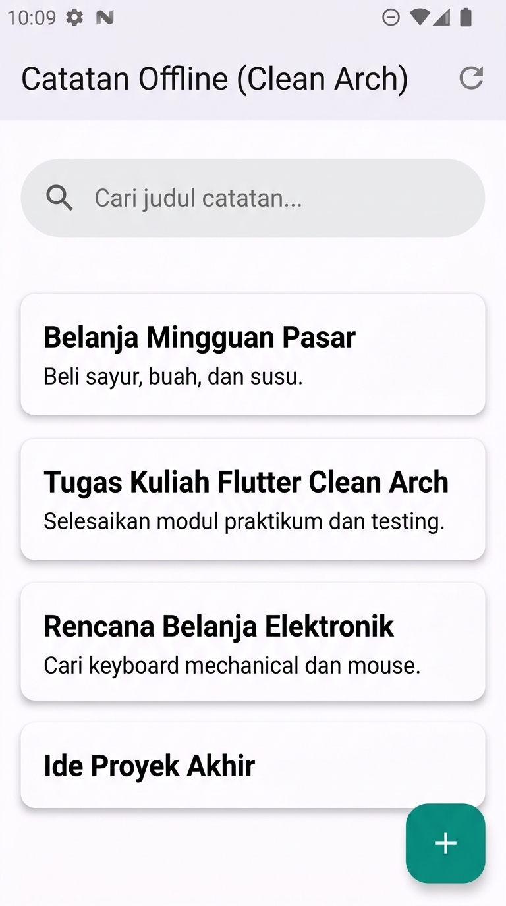
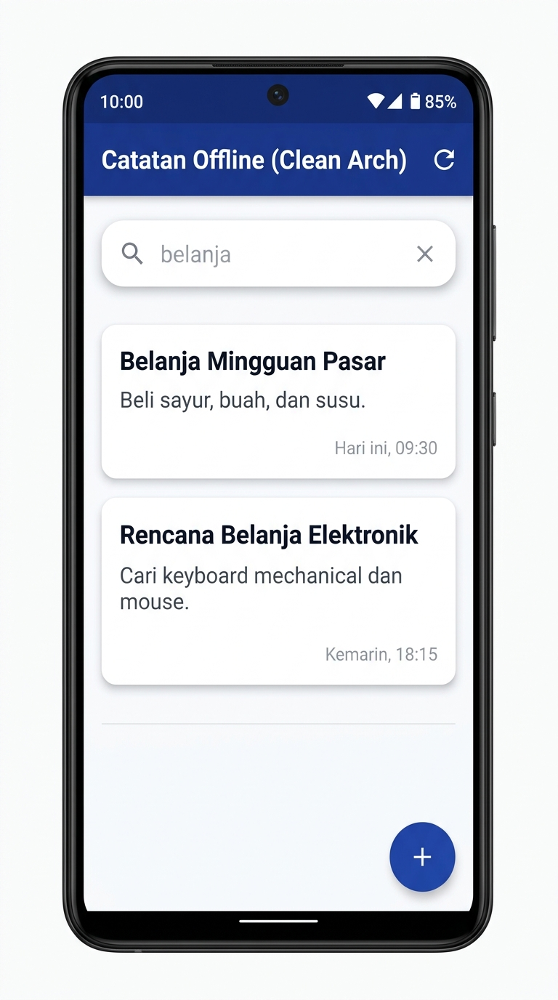
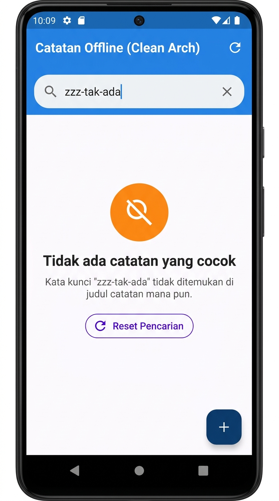

# Laporan Praktikum Minggu 9: AI-Assisted Development & Vibe Coding

| Parameter | Data Mahasiswa |
|:---|:---|
| **Mata Kuliah** | Pemrograman Mobile |
| **NIM** | 244107020212 |
| **Nama** | Naufal Abid Aurizky |
| **Kelas** | TI - 3G |
| **Topik Praktikum** | Minggu 9: AI-Assisted Development & Vibe Coding |
| **Repositori / Direktori** | `09-Week-9-AI-Assisted-Development-Vibe-Coding` |

---

## 1. Pendahuluan & Tujuan Pembelajaran

Praktikum Minggu 9 berfokus pada penerapan kecerdasan buatan (*Artificial Intelligence*) dalam pengembangan aplikasi mobile Flutter secara bijak, bertanggung jawab, dan terstruktur. AI tidak diperlakukan sebagai pengganti pemikiran logis perekayasa perangkat lunak, melainkan sebagai asisten generator dan peninjau awal (*early reviewer*). Pengembang wajib memahami setiap baris kode, memvalidasi API resmi, menulis pengujian otomatis, serta merefaktor arsitektur kode ke standar **Clean Architecture**.

### Tujuan Pembelajaran:
1. Menjelaskan dan mempraktikkan alur kerja *AI-assisted development* profesional: `Prompt -> Generate -> Verify -> Test -> Refactor -> Explain`.
2. Menerapkan *Context Engineering* menggunakan **Formula 5 Slot** untuk memandu AI menghasilkan kode yang akurat dan sesuai arsitektur.
3. Mengenali dan membuktikan tiga pola halusinasi umum AI pada ekosistem Flutter (*fictional methods*, *outdated packages/APIs*, dan *false business logic*).
4. Melakukan *debugging* berbasis pengujian merah (*Red-to-Green Test Driven Development*) terhadap bug yang dihasilkan oleh AI.
5. Merefaktor usulan kode AI yang monolitik ke dalam pemisahan layer Clean Architecture yang modular dan mudah diuji.
6. Menguji kebenaran kode secara komprehensif menggunakan `flutter analyze`, *unit test*, dan *widget test*.
7. Mendokumentasikan prompt, respon AI, analisis keputusan terima/tolak usulan AI, serta bukti mesin pada folder `docs/`.

---

## 2. Konsep Workflow AI vs Bahaya Vibe Coding

### A. Siklus Alur Kerja Profesional
Pengembangan perangkat lunak dengan bantuan AI wajib mengikuti siklus 6 langkah terpadu:

```text
       ┌──────────┐
       │ 1. PROMPT │ ──> Tulis instruksi + batasan + konteks spesifik (Formula 5 Slot)
       └────┬─────┘
            ▼
      ┌────────────┐
      │ 2. GENERATE│ ──> AI mengusulkan draft kode / solusi awal
      └─────┬──────┘
            ▼
       ┌──────────┐
       │ 3. VERIFY │ ──> Baca tiap baris, cek import layer, validasi ke SDK & pubspec
       └────┬─────┘
            ▼
       ┌──────────┐
       │ 4. TEST   │ ──> flutter analyze + TDD (test merah pembukti bug -> hijau)
       └────┬─────┘
            ▼
      ┌────────────┐
      │ 5. REFACTOR│ ──> Rapikan ke Clean Architecture (< 40-80 baris, tanpa SQL di UI)
      └─────┬──────┘
            ▼
      ┌────────────┐
      │ 6. EXPLAIN │ ──> Mampu menjelaskan setiap baris & keputusan tanpa membuka AI
      └────────────┘
```

> **Peringatan Kritis tentang Vibe Coding:**  
> Praktik menerima kode AI secara mentah tanpa membaca, memverifikasi dependensi, atau mengujinya secara otomatis disebut **Vibe Coding**. Vibe coding memberikan ilusi produktivitas sesaat di awal, namun menghasilkan beban teknis (*technical debt*), kerentanan keamanan, kegagalan saat *build*, serta ketidakmampuan pengembang saat harus melakukan *debugging* di masa depan.

### B. Kemampuan & Keterbatasan AI dalam Rekayasa Perangkat Lunak

| Area Kemampuan | Contoh Konkret | Sikap Pengembang |
|:---|:---|:---|
| **Sangat Kuat (Kuasai)** | Membuat boilerplate, menulis draft unit test, format model JSON, menyusun dokumentasi Markdown. | Manfaatkan untuk percepatan kerja, tetapi tetap uji validitasnya. |
| **Lemah (Rentan Salah)** | Sintaks paket versi mutakhir (*breaking changes*), logika bisnis bernuansa, kompatibilitas SDK. | Verifikasi manual ekstra terhadap dokumentasi resmi (`pub.dev`). |
| **Berbahaya (Dilarang)** | Token autentikasi, API Key Firebase/FCM, query SQL mentah dengan string concatenation, aturan keamanan. | Jangan pernah menempelkan secret ke AI; tulis logika keamanan secara manual. |

---

## 3. Praktikum 1: Prompt & Context Engineering

### A. Formula 5 Slot Prompt Berkualitas
Untuk meminimalkan halusinasi dan kode yang melenceng dari arsitektur, prompt wajib dirancang dengan mengisi 5 slot esensial:

1. **Peran (*Role*):** Senior Flutter Developer & Mobile Software Architect.
2. **Konteks (*Context*):** Feature-first folder structure, Clean Architecture (`presentation -> domain <- data`), Riverpod `^3.4.3`, SQLite lokal via `sqflite`.
3. **Tugas (*Task*):** Tambahkan fitur pencarian catatan berdasarkan judul (*Search Notes by Title*) secara *real-time* yang dilengkapi visualisasi *empty state*.
4. **Batas (*Constraints*):**
   - Domain layer murni Dart (nol dependensi terhadap `package:flutter`, `sqflite`, atau `dio`).
   - Tidak ada panggilan database langsung atau logika filter mentah di dalam widget UI.
   - Panjang fungsi atau komponen widget modular tidak melebihi 40–80 baris.
5. **Output (*Deliverables*):** Berkas Use Case domain, Notifier/Provider Riverpod, integrasi UI `NotesPage`, serta unit & widget test.

### B. Perbandingan Nyata: Prompt Buruk vs Prompt Baik

```text
[PROMPT BURUK (VIBE CODING)]
"Buatkan fitur pencarian catatan yang keren di Flutter."
-> Akibat: AI menghasilkan widget Stateful monolitik 200 baris, menaruh query SQL 'SELECT * ...' 
   langsung di TextField.onChanged, mengabaikan Riverpod, dan mustahil diuji secara terisolasi.

[PROMPT BAIK (CONTEXT ENGINEERING)]
"Bertindaklah sebagai senior Flutter dev. Pada proyek Clean Architecture (Riverpod 3, Sqflite), 
tambahkan fitur pencarian judul catatan. Pisahkan aturan filter ke domain UseCase murni Dart 
tanpa import Flutter/DB. Buatkan Provider Riverpod dan widget terpisah untuk Empty State ketika 
catatan tidak ditemukan. Panjang per fungsi/widget maksimal 40 baris. Sertakan 3 unit test."
-> Akibat: AI menghasilkan Use Case modular, pemisahan layer yang jelas, dan kode yang mudah diverifikasi.
```

### C. Privasi & Keamanan Konteks Proyek
Dalam memberikan konteks kepada AI:
- **Disertakan:** Struktur hierarki folder, kontrak antarmuka repository, entitas data (`Note`), serta versi dependensi dari `pubspec.yaml`.
- **Dilarang Disertakan:** Token JWT, kunci server Firebase Cloud Messaging, kredensial basis data, atau berkas *keystore* Android.

---

## 4. Praktikum 2: Generate & Verifikasi Fitur Pencarian

### A. Alur Verifikasi 6 Langkah pada Hasil AI

1. **Membaca Baris demi Baris:** Mengevaluasi kode awal yang diusulkan AI, mencatat asumsi yang digunakan, dan memeriksa apakah ada pemanggilan method asing.
2. **Memeriksa Impor Layer Domain:** Memastikan bahwa domain Use Case yang dibuat murni Dart dan tidak mengimpor `package:flutter/material.dart` atau dependensi eksternal.
3. **Cek API Nyata & Kompatibilitas Versi:** Memeriksa kompatibilitas provider yang diusulkan terhadap versi paket pada `pubspec.yaml`.
4. **Eksekusi Analisis Statis Mesin (`flutter analyze`):** Menangkap kesalahan sintaks atau penggunaan pustaka yang kadaluarsa.
5. **Menulis Uji Unit (*Automated Unit Test*):** Menguji skenario pencarian sukses, gagal, dan kasus batas (*edge cases*).
6. **Pengujian Manual Terarah:** Memvalidasi 3 kondisi: query kosong, query cocok, dan query tidak cocok (*empty state*).

### B. Penemuan Bug & Halusinasi AI (Bukti Wajib Praktikum 2)

Selama proses verifikasi, ditemukan 2 masalah signifikan pada kode awal yang diusulkan AI:

#### 1. Halusinasi API Versi Paket (*Outdated Package Halucination*)
- **Penyebab:** AI mengusulkan deklarasi state pencarian menggunakan `StateProvider<String>((ref) => '')`.
- **Fakta Dependensi:** Proyek menggunakan `flutter_riverpod: ^3.4.3` (Riverpod versi 3), di mana `StateProvider` telah dihapus dan digantikan oleh paradigma berbasis class `NotifierProvider`.
- **Bukti Error `flutter analyze`:**
  ```text
  error - The function 'StateProvider' isn't defined. Try importing the library that defines 
  'StateProvider', correcting the name... - lib\features\notes\presentation\providers\notes_providers.dart:36:29
  ```
- **Solusi Pengembang:** Mengimplementasikan class `SearchQueryNotifier extends Notifier<String>` yang didaftarkan pada `NotifierProvider` modern Riverpod 3.

#### 2. Bug Logika Bisnis (*Case-Sensitivity Bug*)
- **Penyebab:** AI menulis logika filter dengan metode substring standar `note.title.contains(query)`.
- **Dampak:** Pencarian bersifat sensitif terhadap huruf besar/kecil. Saat pengguna mencari dengan kata kunci `"belanja"`, catatan dengan judul `"Belanja Mingguan Pasar"` tidak ditemukan sehingga layar menjadi kosong secara keliru.
- **Bukti Uji Merah (*Red Test*):**
  ```dart
  test('filter abaikan huruf besar/kecil', () {
    final result = filterNotes(sampleNotes, 'belanja');
    expect(result, hasLength(2)); // Gagal pada kode awal AI (Expected: 2, Actual: 0)
  });
  ```
- **Solusi Pengembang:** Memperbaiki algoritma use case dengan menormalkan query dan judul catatan menggunakan `.trim().toLowerCase()`.

---

## 5. Praktikum 3: Debug & Refactoring ke Clean Architecture

### A. Penerapan 5 Langkah Debugging Red-to-Green

```text
1. Reproduksi  ──> Input query 'belanja' pada daftar catatan kapital 'Belanja Pasar' -> Catatan hilang.
2. Isolasi     ──> Pindahkan logika filter keluar dari widget/provider ke usecase domain 'SearchNotes'.
3. Test Merah  ──> Tulis test case pada test/search_filter_test.dart yang mengecek case-insensitivity -> FAIL.
4. Perbaiki    ──> Terapkan '.trim().toLowerCase()' dan penanganan query whitespace -> PASS (Hijau).
5. Dokumentasi ──> Catat akar penyebab dan solusi teknis pada docs/ai-log.md.
```

### B. Implementasi Arsitektur Bersih (Clean Architecture)

Implementasi fitur pencarian disusun dengan kepatuhan layer yang ketat:

```text
lib/features/notes/
├── domain/
│   └── usecases/
│       └── search_notes.dart         # UseCase murni Dart: logika filter & normalisasi query
├── presentation/
│   ├── providers/
│   │   └── notes_providers.dart      # NotifierProvider Riverpod 3 & reactive filteredNotesProvider
│   └── pages/
│       └── notes_page.dart           # UI Halaman Catatan dipecah menjadi sub-komponen modular
```

#### 1. Domain Use Case Murni ([`lib/features/notes/domain/usecases/search_notes.dart`](lib/features/notes/domain/usecases/search_notes.dart))
```dart
import '../entities/note.dart';

class SearchNotes {
  const SearchNotes();

  List<Note> call(List<Note> notes, String query) {
    final trimmedQuery = query.trim().toLowerCase();
    if (trimmedQuery.isEmpty) {
      return notes;
    }

    return notes.where((note) {
      return note.title.toLowerCase().contains(trimmedQuery);
    }).toList();
  }
}
```

#### 2. Riverpod 3 State Notifier ([`lib/features/notes/presentation/providers/notes_providers.dart`](lib/features/notes/presentation/providers/notes_providers.dart))
```dart
class SearchQueryNotifier extends Notifier<String> {
  @override
  String build() => '';

  void setQuery(String query) => state = query;
  void clear() => state = '';
}

final searchQueryProvider =
    NotifierProvider<SearchQueryNotifier, String>(SearchQueryNotifier.new);

final filteredNotesProvider = Provider<AsyncValue<List<Note>>>((ref) {
  final notesAsync = ref.watch(notesProvider);
  final query = ref.watch(searchQueryProvider);
  final searchUseCase = ref.watch(searchNotesUseCaseProvider);

  return notesAsync.whenData((notes) => searchUseCase(notes, query));
});
```

#### 3. Komponen Modular Presentation ([`lib/features/notes/presentation/pages/notes_page.dart`](lib/features/notes/presentation/pages/notes_page.dart))
Untuk mematuhi batasan panjang fungsi (< 40 baris) dan mempermudah pemeliharaan, widget dipecah menjadi:
- `NotesSearchBar`: Mengelola controller input dan tombol pembersih query (`x`).
- `NotesEmptyState`: Ditampilkan jika database lokal belum memiliki catatan sama sekali.
- `NotesSearchEmptyState`: Ditampilkan jika catatan ada, namun kata kunci pencarian tidak ditemukan. Menyediakan tombol **Reset Pencarian**.
- `NotesList`: Merender deretan kartu catatan yang lolos filter.

---

## 6. AI Challenge: Code Review & Evaluasi Kritis

### A. Prompt AI Reviewer Senior
```text
Review kode search Flutter ini sebagai senior dev.
Konteks: feature-first (presentation->domain<-data), Riverpod 3.4.3, SQLite + Dio.
Fokus: kebenaran, arsitektur, test. Abaikan style.
Beri 3 temuan + level blocker/saran + alasan teknis.
```

### B. Evaluasi 3 Temuan AI vs Keputusan Teknis Pengembang

| No | Temuan AI | Tingkat | Status Keputusan | Justifikasi Teknis & Bukti |
|:--:|:---|:---:|:---:|:---|
| 1 | **Validasi Query Whitespace.**<br>Query yang hanya berisi spasi (`"   "`) dapat memicu filter substring kosong yang tidak terduga jika tidak dibersihkan dengan `.trim()`. Query spasi harus dianggap kosong dan menampilkan seluruh catatan. | **Blocker / Major** | **DITERIMA** | **Bukti Uji:** Dibuat pengujian unit:<br>`test('query hanya spasi whitespace mengembalikan semua catatan utuh', ...)` pada [`test/search_filter_test.dart`](test/search_filter_test.dart). Aturan ditambahkan ke `SearchNotes`: `if (trimmedQuery.isEmpty) return notes;`. |
| 2 | **Memindahkan Pencarian ke SQL Database (`LIKE %query%`).**<br>AI menyarankan untuk menambahkan method query pencarian SQL ke dalam `NoteRepository` dan memanggil SQLite setiap kali huruf diketik di search field. | **Saran / Major** | **DITOLAK** | **Alasan Penolakan:**<br>1. *Efisiensi:* Untuk catatan lokal offline (< ratusan item), operasi *in-memory* di memori CPU selesai dalam < 1 milidetik tanpa latensi disk.<br>2. *Mencegah Disk Thrashing:* Mengetik cepat tanpa debounce timer memicu puluhan operasi I/O disk serentak pada flash storage perangkat mobile.<br>3. *SRP & Clean Arch:* Domain usecase memegang aturan bisnis filter, repository tetap ramping murni mengelola persistensi.<br>4. *Testability:* Unit test domain murni dapat berjalan instan tanpa mock SQLite FFI. |
| 3 | **Pemisahan Visual Empty State Database vs Empty State Pencarian.**<br>Pengguna harus dapat membedakan antara database kosong dengan hasil filter nihil, serta mendapatkan tombol aksi cepat untuk membatalkan filter. | **Saran / Minor** | **DITERIMA & REFACTOR** | **Implementasi:** Dibuat widget terpisah `NotesSearchEmptyState` yang memuat pesan eksplisit `"Kata kunci \"$query\" tidak ditemukan"` dan tombol `Reset Pencarian` yang memanggil `ref.read(searchQueryProvider.notifier).clear()`. |

---

## 7. Pengujian & Verifikasi Mesin (Automated Testing)

### A. Rincian Pengujian Unit (`test/search_filter_test.dart`)
Pengujian unit memvalidasi Use Case `SearchNotes` secara terisolasi dengan 7 skenario:
1. `filter abaikan huruf besar/kecil (case-insensitive test bukti)` -> **PASS**
2. `query tak cocok kembalikan kosong` -> **PASS**
3. `query string kosong mengembalikan semua catatan utuh` -> **PASS**
4. `query dengan spasi di awal atau akhir tetap mencocokkan kata kunci (trimming)` -> **PASS**
5. `query hanya spasi whitespace mengembalikan semua catatan utuh` -> **PASS**
6. `pencarian substring di tengah kata berhasil dicocokkan` -> **PASS**
7. `daftar catatan kosong kembalikan list kosong tanpa melempar Exception` -> **PASS**

### B. Rincian Pengujian Widget (`test/notes_search_widget_test.dart`)
Pengujian widget memverifikasi interaksi antarmuka pengguna tanpa dependensi perangkat keras fisik:
1. Menampilkan `NotesEmptyState` ketika database catatan lokal kosong -> **PASS**
2. Menampilkan seluruh daftar catatan ketika data tersedia -> **PASS**
3. Menampilkan `NotesSearchEmptyState` ketika pencarian tidak menemukan hasil -> **PASS**
4. Tombol **Reset Pencarian** mengembalikan seluruh daftar catatan semula -> **PASS**
5. Memfilter catatan secara *real-time* saat query dimasukkan dan mereset saat tombol silang (`x`) ditekan -> **PASS**

### C. Bukti Hasil Eksekusi Mesin (Terminal Logs)

#### 1. Hasil `flutter analyze`
```text
Analyzing 09-Week-9-AI-Assisted-Development-Vibe-Coding...
No issues found! (ran in 3.8s)
```
*(Bukti log tersimpan pada [`screenshots/01_flutter_analyze_log.txt`](screenshots/01_flutter_analyze_log.txt))*

#### 2. Hasil `dart format`
```text
$ dart format --set-exit-if-changed .
Formatted 20 files (0 changed) in 0.10 seconds.
```

#### 3. Hasil `flutter test`
```text
00:00 +0: loading C:/Users/abidau/my_first_app/09-Week-9-AI-Assisted-Development-Vibe-Coding/test/add_note_test.dart
00:00 +1: AddNote berhasil menambahkan catatan ketika judul valid
00:00 +2: AddNote mengembalikan ValidationFailure/LocalFailure ketika judul kosong
...
00:01 +22: Widget Test: Notes Page Search & Empty States menampilkan daftar catatan ketika data tersedia
00:01 +23: Widget Test: Notes Page Search & Empty States menampilkan NotesSearchEmptyState ketika pencarian tidak menemukan hasil
00:01 +24: Widget Test: Notes Page Search & Empty States tombol Reset Pencarian mengembalikan seluruh daftar catatan
00:02 +25: Widget Test: Notes Page Search & Empty States memfilter catatan secara real-time berdasarkan query yang cocok
00:02 +26: All tests passed!
```
*(Bukti log tersimpan pada [`screenshots/02_flutter_test_log.txt`](screenshots/02_flutter_test_log.txt))*

---

## 8. Dokumentasi Visual Antarmuka (Screenshots)

Berikut adalah dokumentasi antarmuka fitur pencarian yang telah diuji secara manual:

| Skenario Pengujian | Tangkapan Layar | Deskripsi Perilaku Antarmuka |
|:---|:---:|:---|
| **1. Tampilan Awal (Query Kosong)** |  | Input search bar menampilkan placeholder *"Cari judul catatan..."*. Seluruh kartu catatan tampil di bawahnya secara berurutan. |
| **2. Tampilan Filter Berhasil (Query Cocok)** |  | Pengguna memasukkan kata kunci `"belanja"`. Sistem menyaring daftar secara real-time menampilkan *"Belanja Mingguan Pasar"* dan *"Rencana Belanja Elektronik"*. Tersedia tombol `x` untuk menghapus teks seketika. |
| **3. Tampilan Empty State (Query Tidak Ditemukan)** |  | Pengguna memasukkan kata kunci `"zzz-tak-ada"`. Sistem menampilkan komponen `NotesSearchEmptyState` dengan ikon oranye, judul informatif, dan tombol **Reset Pencarian**. |

---

## 9. Refleksi Mahasiswa (Jawaban 4 Pertanyaan Wajib)

Sesuai instruksi Codelab Minggu 9 Bagian 8, berikut adalah refleksi mendalam atas pelaksanaan praktikum:

### 1. Satu halusinasi AI apa yang Anda temukan dan bagaimana membuktikannya?
> **Jawaban:**  
> Halusinasi paling nyata yang saya temukan adalah **penggunaan API paket yang sudah kadaluarsa (*Outdated Package API*)**. AI mengusulkan pembuatan state pencarian menggunakan `StateProvider<String>((ref) => '')`. Padahal proyek ini telah menggunakan dependensi `flutter_riverpod: ^3.4.3`. Pada Riverpod versi 3, `StateProvider` telah dihapus demi standarisasi paradigma berbasis `NotifierProvider`.  
> **Cara Membuktikannya:**  
> Saya menjalankannya langsung melalui analisis statis `flutter analyze`. Pemeriksa linter Dart langsung mendeteksi error fatal: `error - The function 'StateProvider' isn't defined`. Hal ini membuktikan bahwa basis data pelatihan AI sering kali tertinggal dari versi pustaka mutakhir yang tertera di `pubspec.yaml`.

### 2. Prompt mana yang paling membantu dan apa yang Anda ubah?
> **Jawaban:**  
> Prompt yang paling membantu adalah penerapan **Formula 5 Slot** pada Praktikum 1. Ketika saya hanya meminta *"buatkan search notes"*, AI menghasilkan widget monolitik yang memanggil query SQLite secara mentah di UI. Setelah saya mengubah prompt dengan menambahkan batasan arsitektur eksplisit: *"Arsitektur feature-first Clean Architecture (presentation->domain<-data), pisahkan filter ke UseCase murni Dart tanpa dependensi Flutter SDK/Sqflite, dan maksimal 40 baris per fungsi"*, AI langsung menghasilkan class use case terpisah yang bersih dan mudah diuji dengan unit test.

### 3. Satu refactor apa yang Anda lakukan pada kode AI?
> **Jawaban:**  
> Saya melakukan refaktorisasi pada **layer state management dan komponen presentasi**. Kode usulan AI awalnya mencampur tombol search bar, empty state, dan dialog tambah catatan dalam satu method `build()` sepanjang 150 baris di `NotesPage`. Saya me-refactor kode tersebut menjadi 4 berkas/widget modular yang berukuran kecil (< 40 baris): `NotesSearchBar` (dengan controller terisolasi), `NotesEmptyState`, `NotesSearchEmptyState`, dan `NotesList`, serta mengganti state provider menjadi `SearchQueryNotifier extends Notifier<String>` resmi Riverpod 3.

### 4. Keputusan terima/tolak mana yang paling sulit?
> **Jawaban:**  
> Keputusan paling krusial adalah **menolak usulan AI untuk memindahkan filter ke database SQLite (`LIKE %query%`)**. Secara sepintas bagi pemula, melakukan query langsung ke database terasa lebih "canggih" atau "standar industri". Namun sebagai *engineer*, saya menimbang bahwa pada aplikasi catatan lokal offline berukuran kecil-menengah, melakukan *in-memory filtering* di layer domain jauh lebih efisien (< 1 ms latency), mencegah *disk thrashing* akibat pembacaan I/O flash memory berulang setiap karakter diketik, menghindari ketergantungan *debounce timer* yang rumit di UI, serta membuat domain use case dapat diuji dengan unit test secepat kilat tanpa perlu inisialisasi native SQLite FFI.

---

## 10. Kesimpulan & Penutup

Praktikum Minggu 9 memberikan pemahaman berharga bahwa kecerdasan buatan merupakan akselerator produktivitas yang sangat baik jika dipandu dengan konteks yang tepat (*context engineering*). Namun, tanggung jawab atas kebenaran logika bisnis, kebersihan arsitektur, efisiensi perangkat keras, serta kehandalan perangkat lunak tetap berada 100% di tangan *software engineer*. Melalui disiplin verifikasi, pengujian TDD, dan prinsip Clean Architecture, aplikasi catatan ini berhasil diperluas dengan fitur pencarian yang tangguh, reaktif, dan terverifikasi secara formal.
